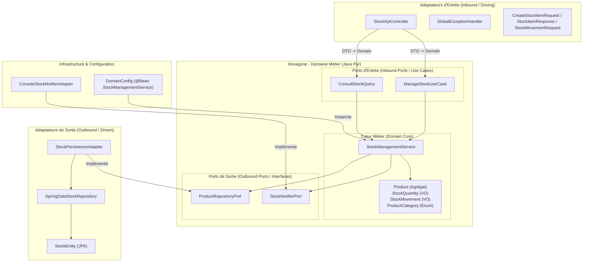

# ADR 0001 : Mise en œuvre de l'Architecture Hexagonale pour le projet de Gestion de Stock

* **Statut :** Accepté
* **Date :** 2026-10-25
* **Auteurs :** Équipe d'Architecture & DevOps
* **Branche concernée :** `step/1-implement-hexa-logic`

---

## 1. Contexte et Problématique

Dans le cadre du développement du microservice de **Gestion de Stock**, nous souhaitons éviter le couplage fort classique entre les règles métiers et le framework applicatif (Spring Boot, JPA, base de données PostgreSQL, HashiCorp Vault).

Les objectifs clés sont :
* Pouvoir faire évoluer ou remplacer les composants d'infrastructure (SGBD, API Web, services de notification) sans impacter la logique métier.
* Permettre une testabilité rapide et autonome du cœur métier (exécutable en quelques millisecondes sans contexte Spring).
* Garantir l'isolation des règles de gestion (immuabilité des objets valeurs, interdiction des stocks négatifs, seuils d'alerte).

---

## 2. Décision d'Architecture

Nous avons adopté l'**Architecture Hexagonale (Ports et Adaptateurs)**.

### Principes d'implémentation retenus :
1. **Isolation stricte du Domaine (`domain/`) :**
   - Le noyau métier (`domain.model`, `domain.service`, `domain.exception`) est rédigé en **Java pur**.
   - **Aucune annotation de framework** (ex: pas de `@Service`, `@Autowired`, `@Entity`, `@JsonProperty`) n'est autorisée dans le domaine.
2. **Définition explicite des Ports (`ports/`) :**
   - **Inbound Ports (Primary/Driver Ports) :** Interfaces définissant les Use Cases du système (`ManageStockUseCase`, `ConsultStockQuery`).
   - **Outbound Ports (Secondary/Driven Ports) :** Interfaces définissant les contrats de dépendances externes (`ProductRepositoryPort`, `StockNotifierPort`).
3. **Instanciation par Configuration Infrastructure (`infrastructure/config`) :**
   - Le service domaine (`StockManagementService`) est déclaré en tant que `@Bean` Spring dans la classe de configuration `DomainConfig`, préservant la pureté de la classe domaine tout en s'intégrant au conteneur IoC Spring.

---

## 3. Schéma Global des Travaux d'Architecture et Développement

---

## 4. Conséquences et Bénéfices

### Positives :
* **Testabilité extrême :** Le domaine est testé via `StockManagementServiceTest` en mémoire sans démarrer Spring ni PostgreSQL.
* **Indépendance technologique :** Le modèle métier manipulate des objets `Product` et `StockQuantity` (Value Objects en `BigDecimal`), complètement dissociés des tables JPA (`StockEntity`).
* **Flexibilité DevOps/Cloud :** L'application est prête à être déployée sur OpenShift avec PostgreSQL et HashiCorp Vault via les adaptateurs appropriés.

### Negatives / Limites :
* **Déduplication / Mapping :** Nécessite des couches de conversion entre DTOs REST, Modèle Domaine et Entités JPA.
* **Boilerplate initial :** Plus grand nombre d'interfaces et de packages dès le démarrage du projet.
